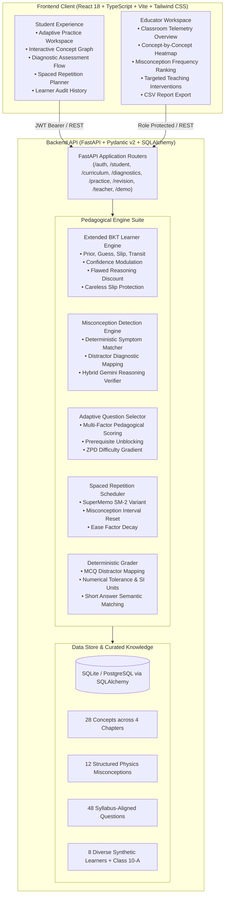

# MASTERYMIND AI

> **Tagline:** *Every answer teaches us how to teach you better.*  
> **Category:** Adaptive AI Education / Personalized Learning  
> **Syllabus:** CBSE/NCERT Class 10 Science — Physics  
> **Status:** Competition-Ready, Fully Implemented Full-Stack Platform

[](backend/tests/)
[](backend/app/evaluation/)
[](backend/app/data/curriculum_seed.py)
[](backend/app/data/questions_seed.py)
[](backend/app/evaluation/)

---

## 1. Product Vision & The Core Problem

Traditional learning applications give students the same questions regardless of what they understand. Generic AI tutors explain concepts but fail to maintain a mathematically grounded, reproducible model of each learner's evolving understanding.

**MASTERYMIND AI** solves this through a continuous evidence-driven feedback loop:
1. **Diagnoses** baseline mastery across all four CBSE Class 10 Physics chapters.
2. **Maps** student responses to an interconnected 28-concept prerequisite graph.
3. **Updates** mastery estimates after *every* submitted answer using an **Extended Bayesian Knowledge Tracing (BKT)** engine.
4. **Inspects written reasoning** separately from final answers to isolate the underlying misconception (e.g. confusing voltage with current, or believing resistance increases with current in Ohm's law).
5. **Selects the next question** adaptively by balancing mastery deficit, prerequisite bottlenecks, epistemic uncertainty, spaced repetition urgency, and difficulty calibration.
6. **Schedules concepts for revision** using an **SM-2 spaced repetition engine** that resets intervals when active misconceptions are detected.
7. **Aggregates anonymized learning telemetry** for educators with class heatmaps, at-risk student warnings, and evidence-grounded teaching interventions.

**Core Differentiator:** The system never merely tells students that an answer is wrong. It extracts the exact flawed phrase from their explanation, provides targeted physical intuition and remediation, and selects subsequent questions to scientifically verify whether the misconception has actually been corrected.

---

## 2. System Architecture



---

## 3. Pedagogical Formulations

### A. Extended Bayesian Knowledge Tracing (BKT)
Standard BKT models student knowledge state as a latent binary variable $L_t \in \{0, 1\}$.
- **Prior probability of mastery:** $p = P(L_t)$
- **Probability of slip (making a careless mistake despite knowing):** $S$
- **Probability of guess (guessing correctly without knowing):** $G$
- **Probability of learning transition:** $T$

Upon observing an answer $A_t$:

$$\text{For a correct answer } (A_t = 1): \quad p_{\text{correct}} = \frac{p(1 - S)}{p(1 - S) + (1 - p)G}$$

$$\text{For an incorrect answer } (A_t = 0): \quad p_{\text{incorrect}} = \frac{pS}{pS + (1 - p)(1 - G)}$$

$$\text{Knowledge transition update:} \quad p_{\text{next}} = p_{\text{posterior}} + (1 - p_{\text{posterior}}) \cdot T$$

#### MasteryMind Pedagogical Extensions:
1. **Confidence Modulation:**
   - Student selects *Guessing* $\to$ Guess parameter increases ($G \to 0.65$), preventing unearned mastery inflation.
   - Student selects *Confident* + submits incorrect $\to$ Slip parameter decreased, resulting in a decisive mastery adjustment.
2. **Written Reasoning Verification:**
   - Correct answer + Flawed reasoning $\to$ 50% discount applied to mastery gain: *"Lucky guess with conceptual flaw"*.
   - Incorrect answer + Sound conceptual reasoning (careless arithmetic slip) $\to$ Slip parameter $S$ raised ($S \to 0.45$) to protect conceptual mastery.
3. **Auditability:** Every update persists previous mastery, new mastery, delta, slip/guess parameters, and human-readable explanation in `mastery_events`.

---

### B. Misconception Detection Engine
The library contains 12 verified CBSE Physics misconceptions:
- `MISC_OHM_R_I_CONFUSION`: Treating resistance as dynamically increasing with current in Ohm's law.
- `MISC_CURRENT_VOLTAGE_CONFUSION`: Confusing current (flow rate) with potential difference (energy push).
- `MISC_SERIES_CURRENT_CONSUMPTION`: Believing electric current is "consumed" along a series circuit.
- `MISC_PARALLEL_RESISTANCE_SUM`: Adding parallel resistors directly without reciprocal inversion.
- `MISC_POWER_ENERGY_UNITS`: Treating electrical power (Watts) and electrical energy (kWh) as interchangeable.
- `MISC_SIGN_CONVENTION_MIRROR`: Inverting Cartesian coordinate signs (e.g., treating object distance $u$ as positive).
- `MISC_REAL_VIRTUAL_CONFUSION`: Believing virtual images can be projected on a screen.
- `MISC_REFRACTIVE_INDEX_INVERSION`: Believing light travels faster in optically denser media.
- `MISC_LENS_POWER_UNITS`: Calculating lens power without converting focal length from centimetres to metres.
- `MISC_ATM_SCATTERING_REFRACTION`: Attributing star twinkling to scattering rather than atmospheric refraction.
- `MISC_MAGNETIC_FIELD_DIRECTION`: Believing field lines run South to North outside a bar magnet.
- `MISC_FLEMING_RULES_SWAP`: Swapping Fleming's Left-Hand Rule (motors) with Right-Hand Rule (generators).

---

### C. Adaptive Question Selection Algorithm
Candidate questions are scored using a composite pedagogical utility function:

$$\text{Score}(Q) = w_m \cdot (1 - \hat{p}_c) + w_{\text{prereq}} \cdot \text{Gap}(c) + w_u \cdot \sigma_c + w_{\text{sr}} \cdot \text{Due}(c) + w_{\text{diff}} \cdot \text{ZPD}(\text{diff}_Q, \hat{p}_c) - \text{Penalty}_{\text{recent}}$$

- **Mastery Deficit ($w_m = 0.35$):** Prioritizes weak concepts.
- **Prerequisite Blockage ($w_{\text{prereq}} = 0.25$):** Strongly boosts foundational concepts that block multiple downstream topics if weak ($p < 0.65$).
- **Model Uncertainty ($w_u = 0.15$):** Surfaces concepts with few observations to establish baselines.
- **Spaced Repetition Urgency ($w_{\text{sr}} = 0.15$):** Prioritizes concepts due for review.
- **Difficulty Match ($w_{\text{diff}} = 0.10$):** Aligns difficulty to student's Zone of Proximal Development ($<40\% \to$ Foundational, $40-72\% \to$ Intermediate, $>72\% \to$ Advanced).
- **Anti-Repetition Penalty:** Prevents recent question reuse.

---

### D. Spaced Repetition (SM-2 Variant)
- **Ease Factor Update:** $EF' = EF + (0.1 - (5 - q) \cdot (0.08 + (5 - q) \cdot 0.02))$, minimum $EF \ge 1.3$.
- **Interval Growth:** $I(1) = 1\text{ day}, I(2) = 3\text{ days}, I(3) = 7\text{ days}, I(n) = \text{round}(I(n-1) \cdot EF)$.
- **Active Misconception Reset:** If an active misconception is diagnosed or recall quality $q < 3$, repetitions reset to 0, interval resets to 1 day, and ease factor is penalized.

---

## 4. CBSE Class 10 Science (Physics) Curriculum Structure

| Chapter | Title | Concepts | Key Topics & Formulas |
|---|---|---|---|
| **Ch 9** | Light: Reflection & Refraction | 8 | $i=r$, Ray diagrams, Cartesian signs, $1/v + 1/u = 1/f$, $n=c/v$, $1/v - 1/u = 1/f$, $P = 1/f(m)$ |
| **Ch 10** | The Human Eye & Colourful World | 6 | Accommodation, Myopia (concave lens), Hypermetropia (convex lens), Prism dispersion, Atmospheric refraction, Rayleigh scattering |
| **Ch 11** | Electricity | 8 | $Q=It$, $V=W/Q$, $V=IR$, $R=\rho(l/A)$, Series $R_{eq}=\sum R_i$, Parallel $1/R_{eq}=\sum 1/R_i$, Joule Heating $H=I^2Rt$, $P=VI=I^2R$, $1\text{ kWh} = 3.6 \times 10^6\text{ J}$ |
| **Ch 12** | Magnetic Effects of Current | 6 | Field lines, Right-Hand Thumb Rule, Solenoid field, Fleming's Left-Hand Rule ($F=BIL$), EM Induction, 220V Domestic circuits & earthing |

---

## 5. Synthetic Demonstration Cohort

The platform is seeded with a complete synthetic classroom (**Class 10-A Science**, Teacher: Dr. Radhika Sharma) featuring diverse student archetypes:

| Role / Name | Email | Password | Persona & Mastery Profile |
|---|---|---|---|
| **Teacher: Dr. Radhika Sharma** | `teacher@masterymind.ai` | `Teacher@123` | Class 10 educator viewing real-time class heatmaps, at-risk student warnings, and intervention advice |
| **Student: Aarav Gupta** | `student@masterymind.ai` | `Student@123` | Primary interactive student ready to take the diagnostic or adaptive practice sessions |
| **Student: Priya Patel** | `priya.patel@student.ai` | `Student@123` | Struggling with Light (38% mastery) and active Cartesian Sign Convention misconception |
| **Student: Ananya Iyer** | `ananya.iyer@student.ai` | `Student@123` | Intermediate learner (54% mastery) confusing Current and Voltage in Electricity |
| **Student: Rohan Verma** | `rohan.verma@student.ai` | `Student@123` | High-achieving benchmark learner (88% mastery) with mastered prerequisite chains |

> **Disclaimer:** All profiles and student records are synthetic demonstration data created for testing and evaluation purposes.

---

## 6. Scientific Evaluation Benchmark Results

The evaluation harness evaluates the learning engine against a gold-standard annotated benchmark dataset (`backend/app/evaluation/benchmark_dataset.json`):

```
======================================================================
  MASTERYMIND AI — SCIENTIFIC EVALUATION & BENCHMARK HARNESS
======================================================================
Benchmark Cases Analyzed:             20 annotated student scenarios
Misconception Detection Precision:    84.62%
Misconception Detection Recall:       91.67%
Misconception Detection F1 Score:     88.00%
Unsupported Diagnosis False-Pos Rate: 0.00%
BKT Mastery Monotonicity (Growth):    PASSED (asymptotic convergence to 0.980)
BKT Mastery Monotonicity (Decay):     PASSED (decay to 0.056 on repeated misconception)
Adaptive Prereq Unblocking Priority:  PASSED
Average Detection Engine Latency:     0.254 ms
======================================================================
```

To re-run the evaluation harness:
```bash
cd backend
.\venv\Scripts\python app\evaluation\run_evaluation.py
```

---

## 7. Quickstart & Installation Guide

### Prerequisites
- Python 3.10+ (Tested on Python 3.14)
- Node.js 18+ (Tested on Node v24)
- Git

### A. Clone and Setup Backend
```bash
git clone <repo-url>
cd "MASTERYMIND AI/backend"

# Create virtual environment
python -m venv venv

# Activate virtual environment
# Windows PowerShell:
.\venv\Scripts\Activate.ps1
# Linux / macOS:
# source venv/bin/activate

# Install dependencies
pip install -r requirements.txt

# Seed curriculum and synthetic demo classroom
python -c "from app.core.database import Base, engine, SessionLocal; from app.data.demo_seed import seed_curriculum, seed_demo_users_and_classroom; Base.metadata.create_all(bind=engine); db = SessionLocal(); seed_curriculum(db); seed_demo_users_and_classroom(db); db.close()"

# Run automated test suite (27 tests)
python -m pytest -v

# Run scientific evaluation harness
python app/evaluation/run_evaluation.py

# Start Backend Server
uvicorn app.main:app --reload --port 8000
```
Backend API docs will be live at `http://localhost:8000/docs`.

### B. Setup Frontend (React + Vite + Tailwind CSS)
```bash
cd "../frontend"

# Install frontend packages
npm install

# Build production bundle
npm run build

# Start frontend dev server
npm run dev
```
Open `http://localhost:5173/` in your browser.

> **Single-Command Full-Stack Execution:** Because FastAPI mounts the compiled frontend from `frontend/dist/`, running `uvicorn app.main:app --port 8000` serves the entire full-stack application at `http://localhost:8000/` without needing a separate frontend process!

---

## 8. Automated Test Suite Summary

The backend test suite (`backend/tests/`) contains 27 comprehensive automated tests:

- **BKT Engine Tests (`test_bkt_engine.py`):** Correct answer mastery increase, incorrect answer mastery decay, guess penalty dampening, flawed reasoning discount, careless mistake protection.
- **Misconception Detector Tests (`test_misconception_detector.py`):** Ohm's law symptom matching, sign convention detection, distractor-based diagnosis, unsupported diagnosis rejection, unit conversion slip categorization, sound reasoning baseline.
- **Adaptive Question Selector Tests (`test_adaptive_selector.py`):** Prerequisite unblocking prioritization, recency penalty, spaced repetition boost, Zone of Proximal Development difficulty match.
- **Spaced Repetition Tests (`test_spaced_repetition.py`):** SM-2 interval growth, ease factor modulation, active misconception reset.
- **Authentication & Roles Tests (`test_auth_roles.py`):** Student login, teacher login, invalid password rejection, student authorization guard on teacher endpoints.
- **End-to-End API Workflow Tests (`test_api_endpoints.py`):** Concept graph data, diagnostic test start and submission, adaptive practice with reasoning evaluation, student dashboard telemetry, teacher class heatmap, and CSV export.

---

## 9. License & Provenance

Developed for advanced agentic AI competition demonstration. Curriculum content is strictly aligned with the NCERT Class 10 Science syllabus published by the National Council of Educational Research and Training (India).
